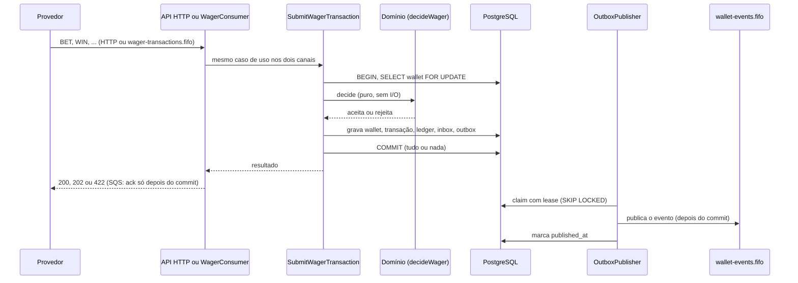

# Distributed Wagering Processor

**Correto mesmo com concorrência e falhas.**


[Apresentação](docs/apresentacao/index.html) · [ARCHITECTURE.md](ARCHITECTURE.md) · [Teste de carga](docs/load-test.md) · [Relatório de segurança (PDF)](docs/security-audit/relatorio-auditoria-seguranca.pdf)

Serviço financeiro que processa transações de aposta (`BET`, `WIN`, `LOSS`, `REFUND`, `ROLLBACK`) vindas de provedores, por HTTP e SQS. Bun, TypeScript estrito, NestJS, PostgreSQL e MikroORM.

## Sumário

- [O problema](#o-problema)
- [Como o sistema continua correto](#como-o-sistema-continua-correto)
- [Arquitetura](#arquitetura)
- [Stack](#stack)
- [Início rápido](#início-rápido)
- [API](#api)
- [Mensageria (SQS)](#mensageria-sqs)
- [Autenticação](#autenticação)
- [Configuração](#configuração)
- [Testes](#testes)
- [Carga](#carga)
- [Observabilidade](#observabilidade)
- [Operação](#operação)
- [Segurança](#segurança)
- [Decisões e trade-offs](#decisões-e-trade-offs)
- [Como demonstrar](#como-demonstrar)
- [Limitações conhecidas](#limitações-conhecidas)
- [Estrutura do repositório](#estrutura-do-repositório)

## O problema

Provedores de jogos enviam `BET`, `WIN`, `LOSS`, `REFUND` e `ROLLBACK` com entrega at-least-once. As mensagens chegam duplicadas, fora de ordem e simultâneas, e o serviço roda em várias instâncias ao mesmo tempo. Um `REFUND` pode chegar antes da aposta que ele reverte, e um processo pode morrer entre o commit e o ack. Dinheiro não pode duplicar nem ficar negativo, e nenhum evento pode se perder.

## Como o sistema continua correto

Cada falha tem um mecanismo no banco ou no fluxo de mensagens e um teste que a provoca com processos e infraestrutura reais.

| Falha | Mecanismo | Prova (teste) |
|---|---|---|
| Duas apostas no mesmo saldo | `SELECT ... FOR UPDATE` por wallet, mais `CHECK (balance >= 0)` no banco | C2 |
| A mesma aposta 50 vezes | `Idempotency-Key` mais `UNIQUE (provider_id, idempotency_key)` | C1 |
| Crash entre commit e ack | Inbox `(consumer_name, message_id)` na mesma transação do saldo | C5 |
| Referência que chega antes da aposta | `PENDING_REFERENCE` mais worker com lease (`SKIP LOCKED`) e backoff | C7 |
| Evento perdido | Outbox transacional mais publicadores com lease e `SKIP LOCKED` | C6 |
| 3 instâncias, uma morta com `SIGKILL` no meio da carga | Todos os mecanismos acima, sem estado em memória | C8 |

Os testes C1 a C6 e C8 estão em `test/concurrency/`; o C7 está em `test/integration/pending-references.test.ts`. O C4 repete C1 e C2 com 3 instâncias da API em round-robin.

### O banco é o juiz

O banco recusa o que o código esqueceria:

- `wallets_balance_non_negative`: `CHECK`, o saldo nunca fica negativo.
- `ledger_balanced`: `CHECK`, o lançamento é aritmeticamente consistente.
- `wager_tx_provider_idempotency_uq`: `UNIQUE (provider_id, idempotency_key)`.
- `wager_tx_one_reversal_per_reference`: índice único parcial, uma reversão por referência.
- `ledger_wallet_currency_fk`: FK composta, o lançamento tem a moeda da wallet.
- `ledger_immutable`: trigger, o lançamento não muda; `wagering_app` também não tem `UPDATE` nem `DELETE` no ledger.
- `wager_tx_guard`: trigger, estado terminal da transação não muda.

A lista completa de invariantes e mecanismos está em [ARCHITECTURE.md §6](ARCHITECTURE.md).

## Arquitetura

### Componentes

```mermaid
flowchart LR
  subgraph PROV["Provedores (at-least-once)"]
    PA["provedor A"]
    PB["provedor B"]
    PC["provedor C"]
  end

  PROV -->|"HTTP"| API["API HTTP (role api)"]
  PROV -->|"SQS, grupo = walletId"| Q["wager-transactions.fifo"]
  Q -->|"maxReceiveCount = 5"| DLQ["wager-transactions-dlq.fifo"]

  subgraph APPS["3 réplicas, mesma imagem"]
    direction TB
    A1["app #1: api, consumer, outbox, pending"]
    A2["app #2: api, consumer, outbox, pending"]
    A3["app #3: api, consumer, outbox, pending"]
  end

  API --> APPS
  Q --> APPS

  subgraph PG["PostgreSQL (1 transação SQL, commit atômico)"]
    T1["wallets"]
    T2["wager_transactions"]
    T3["wallet_ledger_entries"]
    T4["inbox_messages"]
    T5["outbox_messages"]
  end

  APPS -->|"commit"| PG
  PG -->|"claim com lease"| OP["OutboxPublisher"]
  OP --> EV["wallet-events.fifo"]
  EV --> DS["consumidores downstream"]

  APPS -->|"/metrics"| PROM["Prometheus"]
  PROM --> GRAF["Grafana"]
  APPS -.->|"OTel, opcional"| JAE["Jaeger"]
```



No compose local, os papéis `reconciler` e `retention` ficam desligados; cada réplica roda `APP_ROLES=api,consumer,outbox,pending`. Prometheus, Grafana e Jaeger só sobem com o profile `observability`.

### Caminho de uma aposta



### Camadas e papéis

Camadas hexagonais, com dependências para dentro:

- `src/domain`: regras puras (`Money`, `Wallet`, `WagerTransaction`, `decideWager`, eventos). Não importa NestJS, MikroORM, `pg` nem AWS SDK.
- `src/application`: casos de uso e portas (`UnitOfWork`, repositórios, `Clock`, `IdGenerator`, `Metrics`).
- `src/infrastructure`: MikroORM com SQL explícito, SQS, prom-client, pino, OIDC.
- `src/interfaces`: controllers HTTP, consumidor SQS e workers.

Uma imagem, vários papéis. `APP_ROLES` (lista separada por vírgula) decide o que cada processo liga:

| Papel | O que liga |
|---|---|
| `api` | Rotas HTTP |
| `consumer` | `WagerConsumer`, lê `wager-transactions.fifo` |
| `outbox` | `OutboxPublisher`, publica em `wallet-events.fifo` |
| `pending` | `PendingReferenceWorker`, resolve referências pendentes |
| `reconciler` | `ReconciliationWorker`, reconcilia todas as wallets a cada `RECONCILE_INTERVAL_MS` |
| `retention` | `RetentionWorker`, apaga outbox publicada e inbox antigas |

## Stack

| Item | Escolha |
|---|---|
| Runtime e linguagem | Bun 1.4.4, TypeScript estrito |
| Framework HTTP | NestJS 11 (Express), helmet, OpenAPI via `@nestjs/swagger` |
| Persistência | PostgreSQL 17.6, MikroORM 6.6.17 (conexão, transação e migrator) com SQL explícito |
| Mensageria | SQS FIFO, emulado por MiniStack 1.5.35 (`@aws-sdk/client-sqs`) |
| Validação e config | zod 4 |
| Autenticação | OIDC/JWT opcional, `jose` |
| Observabilidade | pino (JSON), prom-client, Prometheus 3.5.0, Grafana 12.1.0, OpenTelemetry e Jaeger 1.62.0 (opcional) |
| Testes | `bun test`, fast-check (testes de propriedade), Postgres e MiniStack reais em containers |
| CI | GitHub Actions |

## Início rápido

**Pré-requisitos**

- [Bun](https://bun.sh) 1.x (testado com 1.4.4)
- Docker com Compose v2 (testado com Docker 29.9.2)

Não é preciso conta em nenhum serviço externo: o SQS roda localmente com [MiniStack](https://github.com/ministackorg/ministack) (imagem `ministackorg/ministack:1.5.35`), que não exige token.

**Setup**

```bash
bun install
cp .env.example .env   # opcional: os valores padrão já apontam para o compose local
```

**Subir a stack local (3 instâncias)**

```bash
docker compose up -d --build --scale app=3
```

Sobe `postgres` (5432), `ministack` (4566), `sqs-init` (cria as filas e sai), `migrate` (roda as migrations como dono do schema e sai) e três instâncias da aplicação, expostas em `3001`, `3002` e `3003`. Cada instância roda com `APP_ROLES=api,consumer,outbox,pending`.

**Health**

```bash
curl localhost:3001/health/live
curl localhost:3002/health/live
curl localhost:3003/health/live
```

**Primeira aposta**

```bash
# 1. cria a wallet (guarde o "id" da resposta)
curl -X POST localhost:3001/wallets \
  -H 'content-type: application/json' \
  -d '{"playerId":"0192f28f-5dc0-7d58-bdb2-814ad6a0f4a1","initialBalance":{"amount":"1000.00","currency":"BRL"}}'

# 2. aposta 25.00 nessa wallet
curl -X POST localhost:3001/wagering/transactions \
  -H 'content-type: application/json' \
  -H 'Idempotency-Key: provider-a:transaction-123' \
  -d '{"providerId":"provider-a","externalTransactionId":"transaction-123","playerId":"0192f28f-5dc0-7d58-bdb2-814ad6a0f4a1","walletId":"<walletId>","roundId":"round-987","gameId":"fortune-chimp","kind":"BET","money":{"amount":"25.00","currency":"BRL"}}'
```

**Portas do host** (padrão entre parênteses), configuráveis por variável de ambiente ou no `.env`:

- `POSTGRES_PORT` (`5432`)
- `SQS_PORT` (`4566`)
- `APP_PORTS` (`3001-3003`): uma porta por réplica; ao mudar, informe um intervalo do mesmo tamanho do `--scale`

Exemplo: `POSTGRES_PORT=55432 APP_PORTS=3011-3013 docker compose up -d --build --scale app=3`.

Essas portas podem colidir com um Postgres ou LocalStack que já esteja rodando na máquina (erro `port is already allocated`). Nesse caso, escolha outra porta. Se for rodar a aplicação fora do compose, aponte `DATABASE_URL` e `SQS_ENDPOINT` para a porta escolhida.

**Parar:** `docker compose down -v`.

> **Senhas de desenvolvimento.** `POSTGRES_PASSWORD`, `WAGERING_OWNER_PASSWORD`, `WAGERING_APP_PASSWORD` e `GRAFANA_ADMIN_PASSWORD` têm defaults de desenvolvimento, listados em `.env.example`. São somente para uso local. Veja [Segurança do ambiente local](#segurança-do-ambiente-local).

### Scripts

| Script | O que faz |
|---|---|
| `bun run start` | Sobe a aplicação (`src/main.ts`), conforme `APP_ROLES` e as variáveis de ambiente |
| `bun run typecheck` | `tsc --noEmit` |
| `bun run test:unit` | Testes unitários (`test/unit`), sem banco nem SQS |
| `bun run test:integration` | Testes de integração contra PostgreSQL e MiniStack de teste |
| `bun run test:concurrency` | Testes de concorrência com processos reais (`test/concurrency`) |
| `bun run test` | Os três acima, em sequência |
| `bun run test:load` | Teste de carga contra a stack local com 3 réplicas (perfis `spread`, `hot`, `mixed` e `sqs`). Metodologia, resultados e análise em [docs/load-test.md](docs/load-test.md) |
| `bun run bench:outbox` | Capacidade do publicador da outbox sem SQS (requer a infra de teste) |
| `bun run migration:up` | Aplica as migrations (usa `MIGRATION_DATABASE_URL`, senão `DATABASE_URL`, senão o owner de teste em `localhost:5433`) |
| `bun run migration:down` | Reverte as migrations |
| `bun run infra:test:up` | Sobe a infra de teste (`docker-compose.test.yml`): Postgres em `5433`, MiniStack em `4567` |
| `bun run infra:test:down` | Derruba a infra de teste e remove os volumes |
| `bun run dlq:list` | Lista mensagens da DLQ de transações (ver [Operação](#operação)) |
| `bun run dlq:redrive` | Move mensagens da DLQ de volta para a fila principal |
| `bun run check:apresentacao` | Valida a apresentação (`docs/apresentacao/check.ts`) |
| `bun run security:report` | Gera o relatório de segurança a partir dos `findings-*.json` (`docs/security-audit/generate-report.ts`) |

## API

Todos os exemplos usam a instância em `localhost:3001`. Dinheiro é sempre `{ "amount": "25.00", "currency": "BRL" }`: string decimal com exatamente 2 casas.

Documentação OpenAPI interativa em <http://localhost:3001/docs> (UI) e <http://localhost:3001/docs-json> (JSON). Só existem com `DOCS_ENABLED=true` (padrão: ligado fora de `NODE_ENV=production`).

### Endpoints

| Método e rota | O que faz |
|---|---|
| `POST /wallets` | Cria wallet |
| `GET /wallets/:walletId` | Consulta wallet |
| `GET /wallets/:walletId/ledger` | Ledger paginado por cursor |
| `POST /wallets/:walletId/reconciliation` | Compara saldo e ledger |
| `POST /wagering/transactions` | Submete uma transação de aposta |
| `GET /wagering/transactions/:transactionId` | Consulta transação pelo id interno |
| `GET /providers/:providerId/wagering/transactions/:externalTransactionId` | Consulta transação pelo id do provedor |
| `GET /health/live` | Processo vivo |
| `GET /health/ready` | PostgreSQL e SQS alcançáveis |
| `GET /metrics` | Métricas Prometheus |

### Headers

- `Idempotency-Key`: obrigatório em `POST /wagering/transactions`. Padrão recomendado: `{providerId}:{externalTransactionId}`.
- `X-Correlation-Id`: opcional. Só é aceito no formato `^[A-Za-z0-9._:-]{1,128}$`; fora dele, o servidor gera um novo.
- `Authorization: Bearer <jwt>`: exigido nas rotas de negócio com `AUTH_MODE=oidc` (ver [Autenticação](#autenticação)).

### Status HTTP

| Status | Quando |
|---|---|
| `200` | Transação `PROCESSED` (nova ou replay, com `idempotentReplay`); consultas |
| `201` | Wallet criada |
| `202` | `PENDING_REFERENCE`: aceita, processamento pendente |
| `400` | Payload inválido, UUID inválido em parâmetro, cursor adulterado, JSON malformado |
| `401` | Token ausente, expirado ou inválido (`UNAUTHORIZED`) |
| `403` | `PROVIDER_MISMATCH` ou `FORBIDDEN_SCOPE` |
| `404` | Consulta sem resultado |
| `409` | Conflito de idempotência ou de `externalTransactionId`; `WALLET_ALREADY_EXISTS` |
| `413` | Body acima de 64 KB (`PAYLOAD_TOO_LARGE`) |
| `422` | Rejeição de regra de negócio, com `failureCode` |
| `503` | Falha transitória de infraestrutura, com `Retry-After: 1` |
| `500` | Erro não previsto, ou replay de transação `FAILED` (não reenviar; investigar) |

Formato de erro: `{ "error": { "code": "...", "message": "..." } }`. Mapeamento completo em [ARCHITECTURE.md §10](ARCHITECTURE.md).

### Criar wallet

```bash
curl -X POST localhost:3001/wallets \
  -H 'content-type: application/json' \
  -d '{"playerId":"0192f28f-5dc0-7d58-bdb2-814ad6a0f4a1","initialBalance":{"amount":"1000.00","currency":"BRL"}}'
```

Resposta `201`: `{"id","playerId","balance","version"}`. Saldo maior que zero gera a transação `OPENING` e o lançamento `CREDIT` na mesma transação SQL. Mesmo `playerId` + moeda de novo dá `409 WALLET_ALREADY_EXISTS`.

### Consultar wallet

```bash
curl localhost:3001/wallets/<walletId>
```

### Ledger (paginado por cursor)

```bash
curl "localhost:3001/wallets/<walletId>/ledger?limit=50"
curl "localhost:3001/wallets/<walletId>/ledger?limit=50&cursor=<nextCursor>"
```

`limit` vai até 200. O cursor é opaco. `nextCursor` é `null` na última página. Cursor adulterado dá `400 INVALID_PAYLOAD`.

### Submeter transação de aposta

```bash
curl -X POST localhost:3001/wagering/transactions \
  -H 'content-type: application/json' \
  -H 'Idempotency-Key: provider-a:transaction-123' \
  -d '{
    "providerId": "provider-a",
    "externalTransactionId": "transaction-123",
    "playerId": "0192f28f-5dc0-7d58-bdb2-814ad6a0f4a1",
    "walletId": "<walletId>",
    "roundId": "round-987",
    "gameId": "fortune-chimp",
    "kind": "BET",
    "money": { "amount": "25.00", "currency": "BRL" }
  }'
```

Status HTTP: `200` processada (`PROCESSED`), `202` pendente de referência (`PENDING_REFERENCE`), `422` rejeitada por regra de negócio (com `failureCode`), `409` conflito de idempotência ou de `externalTransactionId`, `400` payload inválido, `503` falha transitória (com `Retry-After`). Repetir a mesma requisição devolve o resultado original com `"idempotentReplay": true`.

Para `REFUND` e `ROLLBACK`, envie também `"referenceExternalTransactionId": "<externalTransactionId da BET>"`.

### Consultar transação

```bash
curl localhost:3001/wagering/transactions/<transactionId>
curl localhost:3001/providers/provider-a/wagering/transactions/transaction-123
```

### Reconciliação

```bash
curl -X POST localhost:3001/wallets/<walletId>/reconciliation
```

Compara o saldo guardado com o ledger e responde `consistent`, `difference` e `checkedEntries`. Divergência não é corrigida: é logada e contada em `reconciliation_mismatches_total`. O job periódico está em [Operação](#reconciliação-e-retenção).

### Health e métricas

```bash
curl localhost:3001/health/live     # processo vivo
curl localhost:3001/health/ready    # PostgreSQL e SQS alcançáveis
curl localhost:3001/metrics         # Prometheus
```

`/health/ready` faz `SELECT 1` no PostgreSQL e `GetQueueAttributes` na fila principal; se qualquer um falhar, responde `503`.

### Exposição de rotas, body e rate limit

- `/metrics`, `/health/live` e `/health/ready` são para a rede interna. Não exponha a porta da API na internet sem proxy na frente.
- `/docs` e `/docs-json` só existem com `DOCS_ENABLED=true`. O padrão é ligado fora de `NODE_ENV=production` e desligado nele.
- O body JSON é limitado a 64 KB. Acima disso, a resposta é `413` com `{ "error": { "code": "PAYLOAD_TOO_LARGE" } }`.
- A aplicação não tem rate limit. Aplique na borda (API gateway, LB ou nginx). Um limitador em memória por instância não funciona com várias réplicas.

### Códigos de falha: reenviar ou não?

Tabela para o provedor decidir o que fazer com cada `failureCode` (taxonomia completa em [ARCHITECTURE.md §9](ARCHITECTURE.md)).

| Código | Reenviar? | Ação do provedor |
|---|---|---|
| `INVALID_PAYLOAD` | Não | Corrige o payload. Inclui JSON malformado e campos ausentes ou com tipo errado. |
| `INVALID_MONEY` | Não | Corrige o valor. Inclui `0.00`, que é rejeitado para todos os `kind`. |
| `KIND_NOT_ALLOWED` | Não | Corrige o `kind`. `OPENING` é interno. |
| `IDEMPOTENCY_CONFLICT` | Não, com a mesma key | Mesma `Idempotency-Key` com outro payload. Para tentar de novo, use outra key. |
| `EXTERNAL_ID_CONFLICT` | Não, com a mesma key | `externalTransactionId` já usado com outra key. Para tentar de novo, mande um `externalTransactionId` novo. |
| `WALLET_NOT_FOUND`, `WALLET_PLAYER_MISMATCH`, `CURRENCY_MISMATCH` | Não | Corrige os dados da wallet ou do jogador. |
| `INSUFFICIENT_FUNDS` | Não | Desiste da aposta. |
| `REVERSAL_INSUFFICIENT_FUNDS` | Não | Escala para a operação. Não reenviar automaticamente. |
| `REFERENCE_NOT_FOUND` | Não | Investiga a BET de referência. Só chega aqui depois do limite de tentativas. |
| `REFERENCE_MISMATCH`, `REFERENCE_INVALID_KIND`, `REFERENCE_NOT_PROCESSED`, `REFERENCE_ALREADY_REVERSED`, `AMOUNT_MISMATCH` | Não | Corrige a referência ou o valor, ou desiste. |
| `INFRA_UNAVAILABLE` | Sim, com a mesma key | Falha transitória (HTTP `503` com `Retry-After`). Reenviar é seguro. |
| `INFRA_PERMANENT` | Não | Vira `FAILED`. Investiga. |

## Mensageria (SQS)

| Fila | Papel |
|---|---|
| `wager-transactions.fifo` | Entrada de transações. `MessageGroupId = walletId`, `MessageDeduplicationId = messageId` |
| `wager-transactions-dlq.fifo` | DLQ da fila de entrada. `RedrivePolicy` com `maxReceiveCount = 5` |
| `wallet-events.fifo` | Saída: eventos publicados pela outbox. `MessageGroupId = aggregateId`, `MessageDeduplicationId = eventId` |

Os nomes são configuráveis (`WAGER_QUEUE_NAME`, `WAGER_DLQ_NAME`, `WALLET_EVENTS_QUEUE_NAME`). As filas são criadas pelo serviço `sqs-init` (`infra/ministack/init-sqs.sh`).

### Formato da mensagem

Envelope com `messageId`, `type` (`WagerTransactionRequested`), `occurredAt` e `data`. Os campos de `data` são os mesmos do `POST /wagering/transactions`, mais `idempotencyKey`. Sem `data.idempotencyKey`, o padrão é `{providerId}:{externalTransactionId}`.

```bash
aws --endpoint-url http://localhost:4566 sqs send-message \
  --queue-url http://localhost:4566/000000000000/wager-transactions.fifo \
  --message-group-id <walletId> \
  --message-deduplication-id msg-123 \
  --message-body '{"messageId":"msg-123","type":"WagerTransactionRequested","occurredAt":"2026-07-29T15:00:00.000Z","data":{"providerId":"provider-a","externalTransactionId":"transaction-123","idempotencyKey":"provider-a:transaction-123","playerId":"0192f28f-5dc0-7d58-bdb2-814ad6a0f4a1","walletId":"<walletId>","roundId":"round-987","gameId":"fortune-chimp","kind":"BET","money":{"amount":"25.00","currency":"BRL"}}}'
```

Depois do processamento, os eventos aparecem em `wallet-events.fifo`:

```bash
aws --endpoint-url http://localhost:4566 sqs receive-message \
  --queue-url http://localhost:4566/000000000000/wallet-events.fifo --max-number-of-messages 10
```

Credenciais do MiniStack: qualquer valor (`AWS_ACCESS_KEY_ID=test`, `AWS_SECRET_ACCESS_KEY=test`).

Eventos publicados: `WagerTransactionProcessed`, `WagerTransactionRejected`, `WalletBalanceChanged` (só quando o saldo muda), `WagerTransactionPendingReference` e `WalletCreated`. Consumidores de `WalletBalanceChanged` devem ordenar por `data.walletVersion`, não pela ordem de chegada.

### Consumer

O papel `consumer` lê `wager-transactions.fifo` com long polling (`CONSUMER_WAIT_SECONDS`) e até `CONSUMER_CONCURRENCY` mensagens em paralelo por instância. Usa o **mesmo caso de uso** do HTTP (`SubmitWagerTransaction`); a inbox entra na mesma transação SQL do saldo. O ack (`DeleteMessage`) só acontece depois do commit.

| Situação | Ação |
|---|---|
| `PROCESSED`, `REJECTED`, `PENDING_REFERENCE`, conflito, duplicata da inbox | Ack, só depois do commit |
| JSON malformado, envelope inválido, payload ou valor inválido | Permanente: copia para a DLQ com o atributo `reason` e só então apaga da fila principal |
| Infraestrutura transitória, conflito de versão, `lock_timeout` | Sem ack; `ChangeMessageVisibility(min(2^receiveCount, CONSUMER_MAX_BACKOFF_SECONDS))`. Depois de 5 recebimentos, o redrive do SQS move a mensagem para a DLQ |
| Qualquer outro erro | `reason = INFRA_PERMANENT`: grava `FAILED` quando a wallet existe e a key é nova; depois DLQ |

### DLQ

Mensagens que o consumidor não processa vão para `wager-transactions-dlq.fifo` com o atributo `reason`. Como inspecionar e reenviar: [Operação](#dlq-de-transações).

## Autenticação

A autenticação é delegada a um IdP via OIDC/JWT; o serviço só valida tokens. Duas configurações, por `AUTH_MODE`:

- `disabled` (padrão fora de produção): nenhuma rota exige token. É o modo de dev e dos testes.
- `oidc`: exige `OIDC_ISSUER`, `OIDC_AUDIENCE` e `OIDC_JWKS_URL`. O token (`Authorization: Bearer ...`) é verificado com o JWKS do IdP: assinatura RS256 ou ES256, `iss`, `aud` e `exp` (obrigatório: token sem `exp` é recusado). Cada busca do JWKS tem timeout de `OIDC_JWKS_TIMEOUT_MS`. IdP indisponível dá `503 INFRA_UNAVAILABLE`, nunca `200` nem `401`.

Claims usadas: `provider_id` (o provedor) e `scope` (lista separada por espaços; `wallet:admin` marca o operador).

| Rota | Regra | Falha |
|---|---|---|
| `POST /wagering/transactions` | `provider_id` igual a `providerId` do body | 403 `PROVIDER_MISMATCH` |
| `GET /wagering/transactions/:id` | transação do provedor do token | 404 (igual a inexistente) |
| `GET /providers/:providerId/...` | `:providerId` igual a `provider_id` | 403 `PROVIDER_MISMATCH` |
| `/wallets*` (criar, consultar, ledger, reconciliação) | scope `wallet:admin` | 403 `FORBIDDEN_SCOPE` |
| qualquer rota acima | token ausente, expirado ou inválido | 401 `UNAUTHORIZED` |

`/health` e `/metrics` não têm autenticação: o serviço assume rede interna para eles. O consumidor SQS segue como canal interno confiável.

**Validação de produção.** Em produção (qualquer `NODE_ENV` fora de `development` e `test`, inclusive ausente) a configuração é validada na subida: `AUTH_MODE` precisa estar definido, `DATABASE_URL` não pode ter senha padrão nem com menos de 12 caracteres, `AWS_ACCESS_KEY_ID` e `AWS_SECRET_ACCESS_KEY` não podem ser valores de desenvolvimento, e `OIDC_ISSUER` e `OIDC_JWKS_URL` precisam ser `https`. `AUTH_MODE=disabled` em produção sobe, mas registra um aviso.

**Risco aceito: wallet compartilhada entre provedores.** A wallet não pertence a um provedor: qualquer provedor autenticado que conheça `walletId` e `playerId` pode apostar contra ela. Em iGaming a wallet do jogador é a mesma para todos os provedores de jogo, e o desafio não define wallet por provedor. O que limita o risco: o `playerId` precisa bater com a wallet, os IDs são UUID v7 (74 bits aleatórios) e toda operação fica auditada no ledger. **Recomendado em produção:** um launch token (token de sessão de jogo emitido pela plataforma) que vincule jogador, wallet e provedor, com o guard conferindo esse vínculo. Detalhes em [ARCHITECTURE.md §14](ARCHITECTURE.md).

## Configuração

Variáveis lidas por `src/config/config.ts` (e, onde indicado, por `mikro-orm.config.ts` e `main.ts`). `.env.example` traz os valores do compose local.

| Variável | Padrão | Uso |
|---|---|---|
| `NODE_ENV` | ausente | `development` e `test` desligam as validações de produção. Qualquer outro valor, inclusive ausente, é produção. A imagem define `production`; o compose declara `development` |
| `PORT` | `3000` | Porta HTTP |
| `DOCS_ENABLED` | `true` fora de produção, `false` nela | Liga o Swagger UI em `/docs` e o JSON em `/docs-json`. Desligado, ambos respondem 404 |
| `DATABASE_URL` | obrigatória | Conexão do runtime (papel `wagering_app`) |
| `MIGRATION_DATABASE_URL` | `DATABASE_URL` | Conexão de migrations (papel `wagering_owner`). Lida por `mikro-orm.config.ts`; sem as duas, usa o owner de teste em `localhost:5433` |
| `SQS_ENDPOINT` | obrigatória | Endpoint SQS (MiniStack) |
| `AWS_REGION` | `us-east-1` | Região |
| `AWS_ACCESS_KEY_ID` | ausente | Credencial AWS. Em produção, `test` e a chave de exemplo da documentação da AWS são recusadas |
| `AWS_SECRET_ACCESS_KEY` | ausente | Credencial AWS. Em produção, o valor `test` é recusado |
| `APP_ROLES` | `api` | Papéis ativos: `api,consumer,outbox,pending,reconciler,retention` |
| `AUTH_MODE` | ausente (`disabled`) | `disabled` ou `oidc`. Em produção precisa estar definido |
| `OIDC_ISSUER` | ausente | Issuer esperado (`iss`). Obrigatória com `AUTH_MODE=oidc`; `https` em produção |
| `OIDC_AUDIENCE` | ausente | Audience esperada (`aud`). Obrigatória com `AUTH_MODE=oidc` |
| `OIDC_JWKS_URL` | ausente | URL do JWKS do IdP. Obrigatória com `AUTH_MODE=oidc`; `https` em produção |
| `OIDC_JWKS_TIMEOUT_MS` | `2000` | Timeout de cada busca do JWKS |
| `WAGER_QUEUE_NAME` | `wager-transactions.fifo` | Fila de entrada |
| `WAGER_DLQ_NAME` | `wager-transactions-dlq.fifo` | DLQ |
| `WALLET_EVENTS_QUEUE_NAME` | `wallet-events.fifo` | Fila de eventos da outbox |
| `PENDING_MAX_ATTEMPTS` | `10` | Tentativas do worker de pendentes antes de `REFERENCE_NOT_FOUND` |
| `PENDING_POLL_MS` | `1000` | Intervalo do worker de pendentes |
| `RECONCILE_INTERVAL_MS` | `300000` | Intervalo do job de reconciliação (papel `reconciler`). Com várias instâncias com o papel, só uma roda por ciclo (advisory lock) |
| `OUTBOX_RETENTION_HOURS` | `168` | Idade mínima, desde a publicação, para apagar uma linha da outbox (papel `retention`) |
| `INBOX_RETENTION_HOURS` | `168` | Idade mínima, desde o recebimento, para apagar uma linha da inbox. Mínimo `24`; abaixo disso o config falha |
| `RETENTION_INTERVAL_MS` | `3600000` | Intervalo do job de retenção (papel `retention`) |
| `OUTBOX_POLL_MS` | `500` | Intervalo do publicador da outbox |
| `OUTBOX_BATCH_SIZE` | `100` | Linhas reivindicadas (claim) por ciclo do publicador |
| `OUTBOX_SEND_BATCH` | `10` | Entradas por `SendMessageBatch`. Máximo `10`, o limite do SQS |
| `OUTBOX_MAX_ATTEMPTS` | `50` | Tentativas de publicação antes de a linha virar dead letter (`dead_at`) |
| `CONSUMER_CONCURRENCY` | `5` | Mensagens em paralelo por instância |
| `SHUTDOWN_GRACE_MS` | `20000` | Tempo para terminar mensagens em andamento no `SIGTERM` |
| `CONSUMER_VISIBILITY_TIMEOUT_SECONDS` | `30` | VisibilityTimeout do consumidor |
| `CONSUMER_MAX_BACKOFF_SECONDS` | `60` | Teto do backoff de retry |
| `CONSUMER_WAIT_SECONDS` | `10` | Long polling (`0` a `20`) |
| `FAULT_INJECT` | ausente | Só `exit_after_commit`. Uso de teste (cenário C5); só tem efeito com `NODE_ENV=test` |
| `OTEL_EXPORTER_OTLP_ENDPOINT` | ausente | Liga o tracing. Sem a variável, nenhum pacote do OpenTelemetry é carregado. Lida por `main.ts` |
| `OTEL_SERVICE_NAME` | `wagering-processor` | Nome do serviço nos traces |

## Testes

A suíte usa PostgreSQL e MiniStack reais, em containers. Não há mocks de infraestrutura.

| Suíte | Pasta | O que cobre | Quantidade |
|---|---|---|---:|
| Unitários | `test/unit` | Domínio e aplicação, sem I/O. Inclui testes de propriedade com fast-check (`money`, `decideWager`) | 297 |
| Integração | `test/integration` | PostgreSQL e MiniStack reais: schema e constraints, casos de uso, consumer, outbox, pendentes, auth, DLQ, health, retenção, reconciliação | 286 |
| Concorrência | `test/concurrency` | Processos reais em paralelo: C1 a C6 e C8 | 11 |

**Estado atual: 594 testes, 0 falhas em Linux (297 unitários, 286 de integração e 11 de concorrência).** No Windows, os mesmos testes com 1 skip: o de `SIGTERM` com processo real, porque o Windows não entrega `SIGTERM`. Lá o mesmo caminho é coberto dentro do processo, via `app.close()`.

### Infra de teste e isolamento por execução

Antes de qualquer teste de integração ou concorrência:

```bash
bun run infra:test:up
```

Variáveis que os testes aceitam:

- `TEST_DB_NAME` (padrão `wagering`): nome do banco de teste. Cada execução ou pipeline usa o seu para não derrubar os dados dos outros:
  ```bash
  TEST_DB_NAME=wagering_ci bun run test:integration
  ```
  Se o banco não existir, o helper `ensureTestDatabase()` cria com dono `wagering_owner`.
  Com `TEST_DB_NAME` diferente de `wagering`, os testes também criam filas próprias com o sufixo do banco (ex.: `wager-transactions-wagering_ci.fifo`), e por isso execuções paralelas não consomem as mensagens umas das outras.
- `TEST_DB_HOST` (padrão `localhost:5433`), `TEST_SQS_ENDPOINT` (padrão `http://localhost:4567`) e `TEST_DOCKER_HOST` (padrão `localhost`): onde os testes encontram a infraestrutura. Mude só em CI ou dentro de container, por exemplo `TEST_DB_HOST=host.docker.internal:5433`. O teste `db-outage` sobe e para um Postgres próprio com o CLI do `docker`, na porta `55432`.
- `TEST_PORT_BASE` (padrão `4101`): porta base dos processos criados pelos testes de concorrência. Use outro valor para rodar duas execuções ao mesmo tempo (com outro `TEST_DB_NAME` também):
  ```bash
  TEST_PORT_BASE=4201 TEST_DB_NAME=wagering_ci_2 bun run test:concurrency
  ```

Com a infra de teste no ar, `bun run test` roda tudo. Para encerrar: `bun run infra:test:down`.

### CI

O workflow [`.github/workflows/ci.yml`](.github/workflows/ci.yml) roda em `push` e `pull_request`, em `ubuntu-24.04`, com limite de 30 minutos e permissão só de leitura. O job `test` instala as dependências com `bun install --frozen-lockfile`, sobe a infra de teste, roda `typecheck`, `test:unit`, `test:integration` e `test:concurrency` com `TEST_DB_NAME=wagering_ci`, e derruba a infra no fim, mesmo se um passo falhar.

Para reproduzir o job localmente, dentro de um container `oven/bun:1.4.4-alpine`:

```bash
bun run infra:test:up
bash scripts/ci-local.sh
```

O script exige que a infra de teste já esteja de pé no host. Ele usa `TEST_DB_NAME` (padrão `wagering_ci`) e `TEST_PORT_BASE` (padrão `4101`) do ambiente e sai com o código de falha.

## Carga

Rodada mais recente de perfis HTTP (rodada 3, com events sink): 3 réplicas, 50 usuários virtuais em loop fechado, 30 s medidos por perfil.

| Perfil | req/s | p95 | Erros |
|---|---:|---:|---:|
| `spread` (200 wallets) | 1.028,3 | 87,4 ms | 0 |
| `hot` (1 wallet) | 263,8 | 529,9 ms | 0 |
| `mixed` (BET, WIN, LOSS, REFUND e replays) | 1.056,8 | 99,6 ms | 0 |

- **Correção:** a reconciliação de todas as wallets de cada perfil deu 0 divergências. Todos os replays do `mixed` voltaram com `idempotentReplay: true`.
- **`hot`:** uma wallet quente funciona como uma fila no lock (lei de Little), com ~3,6 ms de serviço por transação. Em troca, não há retry nem lost update, e wallets diferentes seguem em paralelo.
- **Perfil `sqs`:** 20.000 `BET` e 1.000 reenvios pela fila: 20.000 `PROCESSED`, 1.000 duplicatas detectadas, 0 na DLQ, 0 divergências. 57,3 transações/s, com a contrapressão incluída.
- **Ressalva sobre o MiniStack.** A publicação da outbox contra o emulador fica em ~100 eventos/s. A causa medida é o emulador: um processo Python com um núcleo saturado, cujo custo de envio cresce com a profundidade da fila. Os números de vazão de eventos e do perfil `sqs` descrevem esse ambiente, não o SQS da AWS. O gerador também divide a CPU com o sistema, e cada rodada é uma execução única de 30 s.
- **Capacidade do publicador sem SQS** (`bun run bench:outbox`): **2.110 eventos/s com 1 publicador e 6.486 eventos/s com 3**, acima dos ~2.400 eventos/s que o teste produz. O código não é o gargalo. Com SQS real isso não foi medido.
- **A correção não é afetada:** o evento é gravado na mesma transação do saldo. O que cresce é a latência de entrega, não o risco de perda. Proteção operacional: alerta em `outbox_lag_seconds`.

Metodologia, ambiente, as quatro rodadas e as limitações do experimento em [docs/load-test.md](docs/load-test.md).

## Observabilidade

- **Logs:** pino em JSON. Contexto por requisição e mensagem (`correlationId`, `messageId`, `transactionId`, `walletId`, `providerId`). Redação de `*.money`, `*.amount`, `*.balance`, `req.body` e `req.headers.authorization`. Depois de cada commit sai uma linha `info` por resultado, sem valores monetários.
- **Métricas** (`GET /metrics`):
  - `wager_transactions_total{status,kind}`
  - `duplicates_detected_total{source,result}`
  - `retries_total{component}`
  - `dlq_messages_total`
  - `lock_conflicts_total`
  - `outbox_lag_seconds`
  - `outbox_dead_total`
  - `processing_duration_seconds`
  - `wallet_lock_wait_seconds`
  - `reconciliation_mismatches_total`, `reconciliation_runs_total`, `reconciliation_wallets_checked_total` e `reconciliation_last_run_timestamp_seconds`
- **Health:** `/health/live` (processo vivo) e `/health/ready` (PostgreSQL e SQS). Durante o shutdown, `/health/ready` responde `503 SHUTTING_DOWN`.

### Prometheus e Grafana (profile `observability`)

Opcional, por profile. Sobe Prometheus e Grafana junto com a stack:

```bash
docker compose --profile observability up -d --build --scale app=3
```

- Prometheus: <http://localhost:9090> (`PROMETHEUS_PORT`, padrão `9090`). Raspa `/metrics` de cada réplica de `app` a cada 5 s, com descoberta por DNS: `--scale app=2` ou `--scale app=3` ajusta os alvos em até 30 s, sem reiniciar o Prometheus. Em Status > Targets, cada réplica aparece como `up`.
- Grafana: <http://localhost:3000> (`GRAFANA_PORT`, padrão `3000`). Acesso anônimo como Viewer; login de administrador `admin` / `admin`. O datasource Prometheus e o dashboard "Wagering processor" (pasta Wagering) vêm provisionados.

A porta `3000` do host pode colidir com outro serviço (erro `port is already allocated`). Troque com `GRAFANA_PORT`, por exemplo `GRAFANA_PORT=3300 docker compose --profile observability up -d`.

Painéis do dashboard:

- **Transações por status:** taxa de `wager_transactions_total` por `status`.
- **Latência de processamento p95:** `processing_duration_seconds` por `source` (`http`, `sqs`, `inbox`).
- **Lag da outbox:** pior evento pendente, em segundos.
- **Retries por componente:** taxa de `retries_total`.
- **Mensagens na DLQ:** total de `dlq_messages_total`; fica vermelho com 1 ou mais.
- **Conflitos de lock:** taxa de `lock_conflicts_total`.
- **Espera pelo lock de wallet p95:** `wallet_lock_wait_seconds`, o tempo do `FOR UPDATE`.
- **Duplicatas detectadas:** taxa de `duplicates_detected_total` por `source` e `result`.

### Tracing (OpenTelemetry e Jaeger, opcional)

O profile também sobe o Jaeger (<http://localhost:16686>, `JAEGER_PORT`). O tracing do app fica desligado até `OTEL_EXPORTER_OTLP_ENDPOINT` ser definido; sem a variável, nenhum pacote do OpenTelemetry é carregado.

```bash
OTEL_EXPORTER_OTLP_ENDPOINT=http://jaeger:4318 docker compose --profile observability up -d --build --scale app=3
```

Spans manuais (sem auto-instrumentação): `http.request`, `wager.submit` (atributos `transaction.id`, `wallet.id`, `provider.id`, `outcome`, `source`), `db.transaction`, `sqs.receive`, `sqs.process` e `outbox.publish_batch`. Nenhum atributo carrega valor monetário. O `traceparent` viaja como atributo de mensagem do SQS: o consumidor continua o trace de quem enviou, e o publicador da outbox grava o seu no evento (o payload não muda).

Para derrubar com os volumes: `docker compose --profile observability down -v`.

## Operação

### DLQ de transações

Mensagens que o consumidor não consegue processar vão para `wager-transactions-dlq.fifo` com o atributo `reason`. Três casos chegam aqui:

- `INVALID_PAYLOAD`: payload inválido. Vai falhar de novo se for reenviado sem correção.
- Retries esgotados: o consumidor tentou várias vezes e a infraestrutura (banco, rede) estava indisponível.
- `INFRA_PERMANENT`: falha de infraestrutura permanente. A transação já ficou `FAILED`, que é terminal.

```bash
bun run dlq:list [--limit 10]
```

Imprime `messageId`, `reason` e os primeiros 120 caracteres do corpo, sem o campo `money`. Mensagens `INFRA_PERMANENT` vêm marcadas como `FAILED (terminal)`. Não remove nada da DLQ.

```bash
bun run dlq:redrive [--reason INVALID_PAYLOAD] [--max 100] [--dry-run] [--include-failed]
```

Move mensagens da DLQ para `wager-transactions.fifo`:

- `--reason`: move só as mensagens com esse motivo.
- `--max`: limite de mensagens movidas (padrão `100`).
- `--dry-run`: mostra quantas seriam movidas e não move nada.
- `--include-failed`: move também as `INFRA_PERMANENT`, que são puladas por padrão. Imprime um aviso.

Por padrão, o redrive pula as `INFRA_PERMANENT` e informa quantas foram puladas.

**Quando o redrive faz sentido:** as mensagens falharam por retries esgotados durante uma indisponibilidade de infraestrutura. Depois que a infra voltou, o redrive as reprocessa e a aposta é aplicada.

**Quando não faz sentido:**

- Payload inválido (`INVALID_PAYLOAD`): reenviar o mesmo corpo vai falhar de novo. Corrija a origem antes.
- `INFRA_PERMANENT`: a transação já está `FAILED`. Um redrive só devolveria o replay do `FAILED`, sem aplicar a aposta. A solução é o provedor reenviar a aposta com um `externalTransactionId` novo.

Cada mensagem é copiada com um `MessageDeduplicationId` novo e só é apagada da DLQ depois do envio. O `messageId` do corpo não muda, então reenviar uma mensagem que já foi processada não duplica o débito: a inbox e a idempotência absorvem a reentrega.

Limitação do FIFO: uma mensagem em voo bloqueia as da mesma `walletId` até voltar. Com `--reason`, mensagens de outro motivo da mesma wallet podem ficar para a próxima execução.

### Reconciliação e retenção

A reconciliação sob demanda é o endpoint `POST /wallets/<walletId>/reconciliation` (ver [API](#reconciliação)). Ela compara o saldo guardado com o ledger e não corrige nada.

Com o papel `reconciler` em `APP_ROLES`, um job reconcilia todas as wallets a cada `RECONCILE_INTERVAL_MS`. Com várias instâncias com o papel, só uma roda por ciclo (advisory lock). Métricas: `reconciliation_runs_total`, `reconciliation_wallets_checked_total` e `reconciliation_last_run_timestamp_seconds`.

Com o papel `retention`, um job apaga em lotes a outbox já publicada e a inbox mais velhas que a retenção (`OUTBOX_RETENTION_HOURS`, `INBOX_RETENTION_HOURS`). Outbox ainda não publicada nunca é apagada, nem a que virou dead letter. Só uma instância roda por ciclo. Os dois papéis ficam desligados no compose por padrão.

### Outbox em dead letter

Uma linha da outbox com falha permanente de envio, ou com `OUTBOX_MAX_ATTEMPTS` esgotado, recebe `dead_at` e `last_error`, gera log `error` e incrementa `outbox_dead_total`. Ela fica na tabela para inspeção e não é reenviada. Reabrir é manual: `UPDATE outbox_messages SET dead_at = NULL, last_error = NULL, attempts = 0 WHERE id = ...`.

### Shutdown

No `SIGTERM`, o consumidor para de iniciar novos `receive`, espera as mensagens em andamento por até `SHUTDOWN_GRACE_MS` (padrão 20 s) e devolve as restantes com `ChangeMessageVisibility(0)`. Os workers param entre itens. Durante esse tempo, `/health/ready` responde `503 SHUTTING_DOWN`. O `stop_grace_period` do serviço `app` no compose é 40 s: o pior caso de shutdown é o long poll em curso (10 s) mais o prazo das mensagens (20 s), mais folga para fechar o ORM. Se o processo for morto mesmo assim, a mensagem volta pelo visibility timeout e a inbox impede a dupla aplicação.

## Segurança

Duas rodadas de auditoria independentes (auditores A e B), com os achados consolidados em relatório.

| Rodada | Achados | Situação |
|---|---|---|
| 1 | 20 (2 altos, 9 médios, 7 baixos, 2 informativos) | 0 abertos |
| 2 | 21 (0 críticos, 0 altos, 5 médios, 10 baixos, 6 informativos) | 0 abertos: 13 corrigidos, 7 aceitos, 1 documentado |

O que está protegido:

- Isolamento por provedor: o claim `provider_id` é conferido em todos os caminhos que agem em nome de um provedor; a transação de outro provedor responde `404`, igual a uma inexistente.
- Verificação do JWT: algoritmos restritos (RS256 e ES256), `exp` obrigatório, timeout do JWKS, falha do IdP em modo fail-closed (`503`).
- Configuração de produção fail-safe: `NODE_ENV` fora de `development` e `test` ativa as validações (senha de banco padrão ou curta, chaves AWS de desenvolvimento, JWKS e issuer só `https`).
- Privilégio mínimo no banco: `wagering_app` sem `DELETE` (exceto outbox e inbox, para a retenção) nem `UPDATE` no ledger, que ainda tem trigger de imutabilidade.
- SQL sempre parametrizado, helmet, `X-Powered-By` desligado, body limitado a 64 KB, `X-Correlation-Id` validado e logs sem valores monetários nem tokens.
- Imagem Docker sem root (`USER bun`), portas do compose só em `127.0.0.1` e actions do CI fixadas por SHA.

Os riscos aceitos e documentados estão no relatório; o principal é a wallet compartilhada entre provedores ([Autenticação](#autenticação)).

Relatórios em PDF: [rodada 2](docs/security-audit/relatorio-auditoria-seguranca.pdf) (atual) e [rodada 1](docs/security-audit/round-1/relatorio-auditoria-seguranca.pdf). Os achados estruturados ficam em `docs/security-audit/findings-a.json` e `findings-b.json`, e `bun run security:report` regenera o relatório.

### Segurança do ambiente local

- Todas as portas publicadas pelo compose (`postgres`, `ministack`, `app`, `prometheus`, `jaeger`, `grafana`) fazem bind em `127.0.0.1`. Nenhuma fica acessível pela rede. Para acessar de outra máquina, use um túnel SSH; não troque o bind.
- As senhas `POSTGRES_PASSWORD`, `WAGERING_OWNER_PASSWORD`, `WAGERING_APP_PASSWORD` e `GRAFANA_ADMIN_PASSWORD` têm defaults de desenvolvimento, listados em `.env.example`. São somente desenvolvimento local. Para trocá-las, defina no `.env`.
- As chaves `test`/`test` do SQS valem só para o emulador MiniStack. Com AWS real, o consumer deve usar IAM role, nunca essas chaves.
- Em produção (qualquer `NODE_ENV` que não seja `development` nem `test`), o startup recusa `DATABASE_URL` com senha padrão ou com menos de 12 caracteres. A checagem lê a senha já decodificada da URL. Ela não substitui um gerenciador de segredos: injete as senhas reais por ele.
- O Grafana aceita acesso anônimo só como `Viewer`, e só com o profile `observability`.

## Decisões e trade-offs

Resumo; a justificativa completa está em [ARCHITECTURE.md](ARCHITECTURE.md).

- **Lock pessimista por wallet, não otimista.** Por quê: em wallet quente, o retry do lock otimista vira tempestade. Custo: apostas da mesma wallet esperam na fila do lock (visível no perfil `hot`).
- **Uma reversão no total (desvio da regra 4).** O desafio fala em uma reversão por tipo; o sistema aceita uma no total. Por quê: `REFUND` e `ROLLBACK` da mesma `BET` creditariam duas vezes. Garantido por índice único parcial.
- **SQL explícito, sem `EntitySchema`.** Por quê: as garantias estão no banco (triggers, índices parciais, `CHECK` compostos, `SKIP LOCKED`) e o `EntitySchema` não as expressa. Custo: o mapeamento é escrito à mão.
- **MiniStack em vez de LocalStack.** Por quê: o LocalStack exige token para subir, e o avaliador precisa rodar sem conta. Custo: é emulação, e pode haver diferenças com a AWS.
- **Autenticação via IdP (OIDC), opcional.** O serviço só valida o JWT; `provider_id` precisa bater com a rota e as wallets exigem `wallet:admin`. Custo: precisa de IdP externo em produção; o startup de produção exige `AUTH_MODE` explícito.
- **`FAILED` é terminal.** Por quê: o trigger `wager_tx_guard` bloqueia mudança de estado final. Custo: a correção é operacional, pela DLQ e por um `externalTransactionId` novo.
- **Outbox at-least-once, com ordem best-effort.** Por quê: publicar depois do commit, com lease, nunca perde evento. Custo: pode haver reentrega e reordenação; o consumidor deduplica por `eventId` e ordena por `walletVersion`.

## Como demonstrar

Pré-condição: stack limpa (`docker compose down -v` e depois `docker compose up -d --build --scale app=3`). O banco guarda o `playerId` e as `Idempotency-Key`; para repetir a demonstração, reinicie a stack.

Rode os blocos na ordem, no mesmo shell, porque eles usam variáveis definidas antes.

```bash
B=localhost:3001
PLAYER=0192f28f-5dc0-7d58-bdb2-814ad6a0f4a3
```

**a) Criar wallet de 100.00 BRL**

```bash
WALLET=$(curl -s -X POST $B/wallets -H 'content-type: application/json' \
  -d "{\"playerId\":\"$PLAYER\",\"initialBalance\":{\"amount\":\"100.00\",\"currency\":\"BRL\"}}" \
  | sed -E 's/.*"id":"([^"]+)".*/\1/')
echo $WALLET
```

**b) Duas BETs de 80.00 em paralelo:** uma responde `200 PROCESSED` e a outra `422 INSUFFICIENT_FUNDS`. Qual das duas recebe `200` depende da ordem de chegada.

```bash
curl -s -w ' HTTP %{http_code}\n' -X POST $B/wagering/transactions \
  -H 'content-type: application/json' -H 'Idempotency-Key: provider-a:bet-demo-a' \
  -d "{\"providerId\":\"provider-a\",\"externalTransactionId\":\"bet-demo-a\",\"playerId\":\"$PLAYER\",\"walletId\":\"$WALLET\",\"roundId\":\"round-987\",\"gameId\":\"fortune-chimp\",\"kind\":\"BET\",\"money\":{\"amount\":\"80.00\",\"currency\":\"BRL\"}}" &
curl -s -w ' HTTP %{http_code}\n' -X POST $B/wagering/transactions \
  -H 'content-type: application/json' -H 'Idempotency-Key: provider-a:bet-demo-b' \
  -d "{\"providerId\":\"provider-a\",\"externalTransactionId\":\"bet-demo-b\",\"playerId\":\"$PLAYER\",\"walletId\":\"$WALLET\",\"roundId\":\"round-987\",\"gameId\":\"fortune-chimp\",\"kind\":\"BET\",\"money\":{\"amount\":\"80.00\",\"currency\":\"BRL\"}}" &
wait
```

**c) Replay:** repete `bet-demo-a`. Devolve o mesmo resultado de antes, com `"idempotentReplay": true`.

```bash
curl -s -w ' HTTP %{http_code}\n' -X POST $B/wagering/transactions \
  -H 'content-type: application/json' -H 'Idempotency-Key: provider-a:bet-demo-a' \
  -d "{\"providerId\":\"provider-a\",\"externalTransactionId\":\"bet-demo-a\",\"playerId\":\"$PLAYER\",\"walletId\":\"$WALLET\",\"roundId\":\"round-987\",\"gameId\":\"fortune-chimp\",\"kind\":\"BET\",\"money\":{\"amount\":\"80.00\",\"currency\":\"BRL\"}}"
```

**d) Mesma `Idempotency-Key`, outro valor:** `409 IDEMPOTENCY_CONFLICT`.

```bash
curl -s -w ' HTTP %{http_code}\n' -X POST $B/wagering/transactions \
  -H 'content-type: application/json' -H 'Idempotency-Key: provider-a:bet-demo-a' \
  -d "{\"providerId\":\"provider-a\",\"externalTransactionId\":\"bet-demo-a\",\"playerId\":\"$PLAYER\",\"walletId\":\"$WALLET\",\"roundId\":\"round-987\",\"gameId\":\"fortune-chimp\",\"kind\":\"BET\",\"money\":{\"amount\":\"10.00\",\"currency\":\"BRL\"}}"
```

**e) REFUND antes da BET:** o REFUND responde `202 PENDING_REFERENCE`. Depois da BET de referência (`bet-demo-c`, 20.00, que cabe no saldo de 20.00 restante), o REFUND é resolvido pelo worker de pendentes, em até ~1 s. O `sleep 2` antes do GET espera isso; o GET deve mostrar `"status":"PROCESSED"`.

```bash
curl -s -w ' HTTP %{http_code}\n' -X POST $B/wagering/transactions \
  -H 'content-type: application/json' -H 'Idempotency-Key: provider-a:refund-demo-1' \
  -d "{\"providerId\":\"provider-a\",\"externalTransactionId\":\"refund-demo-1\",\"referenceExternalTransactionId\":\"bet-demo-c\",\"playerId\":\"$PLAYER\",\"walletId\":\"$WALLET\",\"roundId\":\"round-987\",\"gameId\":\"fortune-chimp\",\"kind\":\"REFUND\",\"money\":{\"amount\":\"20.00\",\"currency\":\"BRL\"}}"

curl -s -w ' HTTP %{http_code}\n' -X POST $B/wagering/transactions \
  -H 'content-type: application/json' -H 'Idempotency-Key: provider-a:bet-demo-c' \
  -d "{\"providerId\":\"provider-a\",\"externalTransactionId\":\"bet-demo-c\",\"playerId\":\"$PLAYER\",\"walletId\":\"$WALLET\",\"roundId\":\"round-987\",\"gameId\":\"fortune-chimp\",\"kind\":\"BET\",\"money\":{\"amount\":\"20.00\",\"currency\":\"BRL\"}}"

sleep 2
curl -s -w ' HTTP %{http_code}\n' $B/providers/provider-a/wagering/transactions/refund-demo-1
```

**f) Reconciliação:** `consistent: true`.

```bash
curl -s -X POST $B/wallets/$WALLET/reconciliation
```

**g) Métrica de transações:**

```bash
curl -s $B/metrics | grep wager_transactions_total
```

## Limitações conhecidas

Resumo de [ARCHITECTURE.md §18](ARCHITECTURE.md).

- Sem reversão parcial: `REFUND` e `ROLLBACK` têm que bater o valor da referência.
- A reconciliação detecta, não corrige: divergência vira log, métrica e `consistent: false`.
- Os cenários de teste usam só `BRL`. Multi-moeda está no modelo; o conflito de moeda é testado com `USD`.
- Sem ledger de partidas dobradas (opcional no desafio).
- A publicação da outbox contra o MiniStack fica em ~100 eventos/s e o backlog cresce sob carga sustentada. Afeta a latência de entrega dos eventos, não a correção. A capacidade do código é maior (ver [Carga](#carga)), mas não foi medida com SQS real.
- O MiniStack é uma emulação: comportamentos finos de SQS FIFO foram conferidos só nos pontos que o sistema usa, não contra a AWS.
- Cadeias de pendentes (referência que também está `PENDING_REFERENCE`) sempre terminam, mas levam o tempo da raiz mais um ciclo do worker por nível.
- Wallet compartilhada entre provedores: risco aceito, com launch token recomendado em produção.
- Sem rate limit na aplicação: aplique na borda. O limite de body (64 KB) é o único limite de tamanho.
- O teste de `SIGTERM` com processo real é pulado no Windows.
- Ordem dos eventos por wallet na outbox é best-effort: consumidores ordenam por `data.walletVersion`.

## Estrutura do repositório

```
.github/
  workflows/ci.yml           # typecheck e as três suítes
docs/
  apresentacao/              # apresentação HTML (index.html) e check.ts
  security-audit/            # findings-a/b.json, relatório (PDF e HTML), round-1/, generate-report.ts
  load-test.md               # metodologia, rodadas e análise
  load-test/                 # resultados brutos (JSON) de cada rodada
infra/
  postgres/init-roles.sql    # papéis wagering_owner e wagering_app
  ministack/init-sqs.sh      # filas FIFO, DLQ e RedrivePolicy (maxReceiveCount 5)
  prometheus/                # scrape das réplicas
  grafana/                   # datasource e dashboard provisionados
scripts/
  dlq.ts                     # dlq:list e dlq:redrive
  load-test.ts               # test:load
  outbox-capacity.ts         # bench:outbox
  ci-local.sh                # reproduz o job de CI num container
src/
  domain/                    # regras puras: Money, Wallet, WagerTransaction, decideWager, eventos
  application/               # casos de uso e portas (UnitOfWork, repositórios, Clock, IdGenerator, Metrics)
  infrastructure/            # MikroORM, repositórios SQL, SQS, auth, observabilidade
  interfaces/                # controllers HTTP, consumidor SQS, workers (outbox, pendentes, reconciliação, retenção)
  config/                    # variáveis de ambiente validadas com zod
test/
  unit/                      # domínio e aplicação, sem I/O
  integration/               # PostgreSQL e MiniStack reais
  concurrency/               # processos reais em paralelo
  helpers/                   # harness, factories, helpers de SQS e banco
ARCHITECTURE.md              # decisões, trade-offs e limitações
docker-compose.yml           # stack local (e profile observability)
docker-compose.test.yml      # infra de teste (Postgres 5433, MiniStack 4567)
Dockerfile                   # oven/bun:1.4.4-alpine, usuário não-root
mikro-orm.config.ts          # configuração do migrator
```
